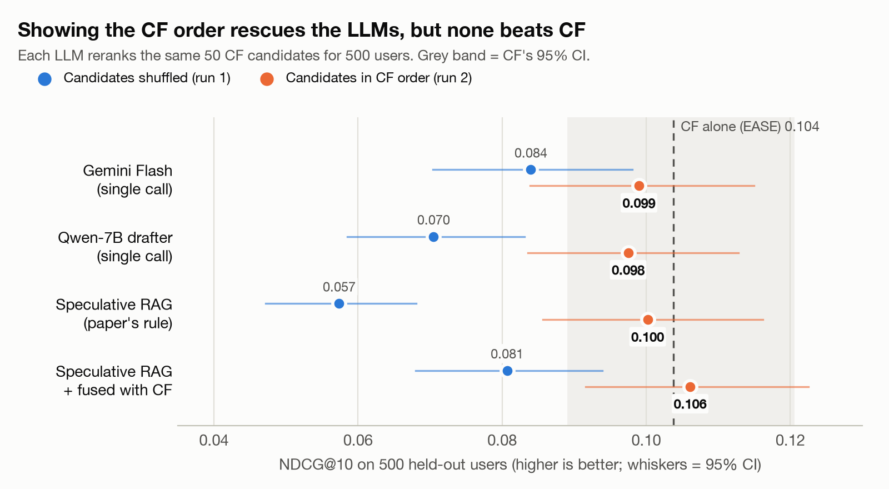
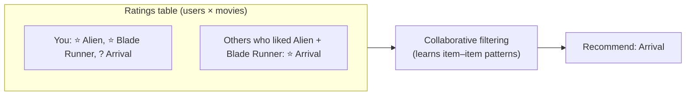
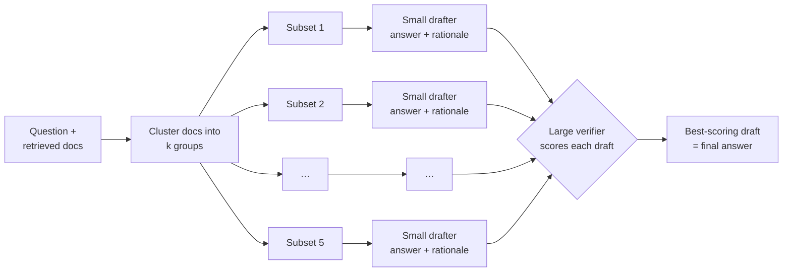
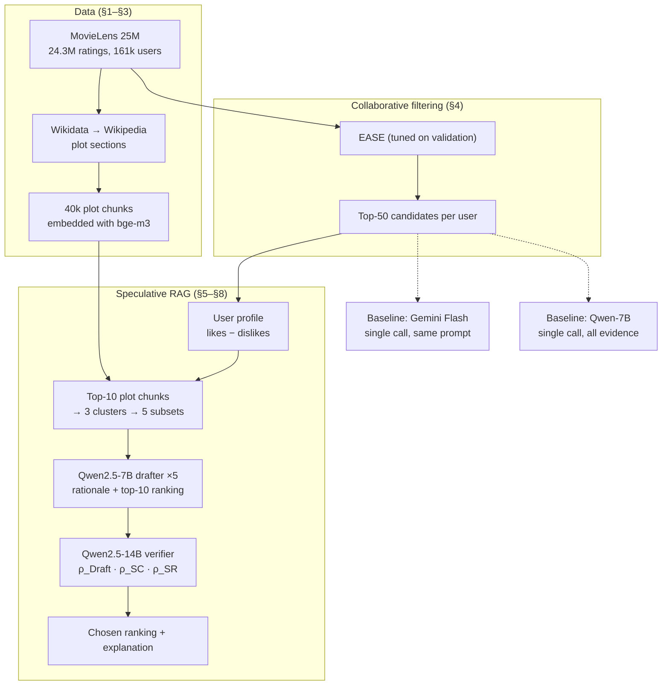
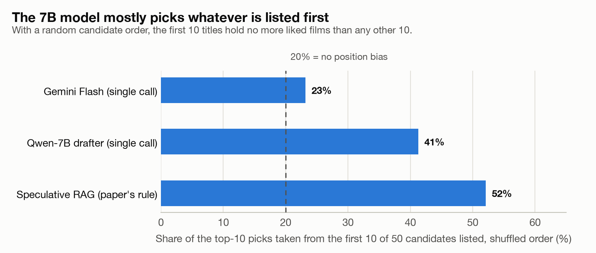
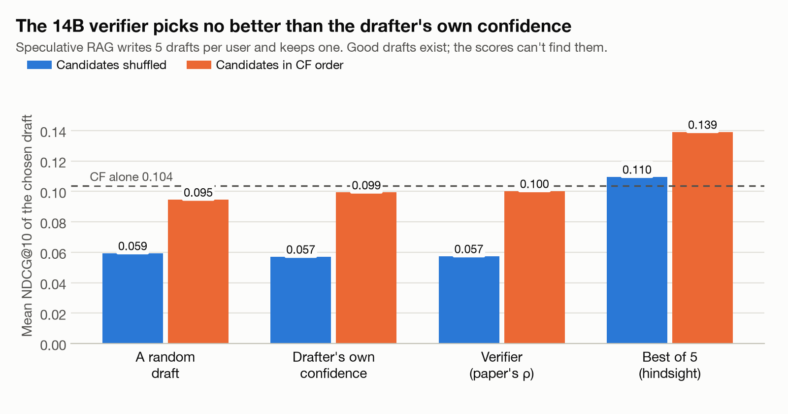
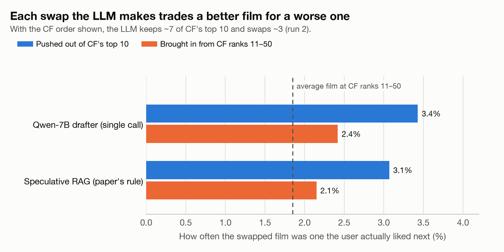

# Speculative RAG vs Collaborative Filtering

**Can an LLM that reads plot summaries recommend movies better than classic collaborative filtering?**

This repo tests [Speculative RAG](https://arxiv.org/abs/2407.08223) (Wang et al., 2024), a draft-then-verify RAG method built for question answering, as a **reranker for movie recommendations**. It compares it against strong collaborative-filtering (CF) baselines on real MovieLens users, using held-out future ratings.

<picture>
  <source media="(prefers-color-scheme: dark)" srcset="figures/fig_headline_dark.png">
  
</picture>

### Results at a glance

| | |
|---|---|
| 🥇 **CF still wins** | A tuned CF model (EASE) scores NDCG@10 = **0.104**. No LLM system beats it by a statistically meaningful margin. |
| 🔀 **Order is everything** | If the LLM sees the candidates in random order, it falls well below CF (Speculative RAG scores **0.057**). If it sees CF's order, it catches up (**0.100**). |
| 🧐 **The verifier doesn't help** | Speculative RAG's 14B verifier picks drafts no better than the 7B drafter's own confidence, even though one of the 5 drafts would score **0.139**. |
| 💸 **It costs more** | Speculative RAG takes **2.6×** the GPU time of a single LLM call for the same accuracy. |

---

## Contents
1. [Background in two minutes](#1-background-in-two-minutes)
2. [What was built](#2-what-was-built)
3. [Experiment design](#3-experiment-design)
4. [Results](#4-results)
5. [What it means](#5-what-it-means)
6. [Reproduce it](#6-reproduce-it)
7. [Repository layout](#7-repository-layout)

---

## 1. Background in two minutes

### Recommender systems and collaborative filtering

A recommender's data is a big, mostly empty **users × items** table of ratings. The job is to guess which empty cells a user would rate highly.

**Collaborative filtering** learns only from that table: *people who liked what you liked also liked X*. It never looks at what a movie is about.



The CF baselines used here:

| Model | Idea in one line |
|---|---|
| Popularity | Recommend what most people liked. The floor. |
| ItemKNN | Recommend movies similar to ones you liked, where similarity comes from co-ratings. |
| ALS | Factorise the ratings table into user and movie vectors. |
| **EASE** | A closed-form linear model that learns how each movie predicts every other movie. It's simple and it's strong: the best baseline here, and the **candidate generator** for the LLMs. |

**How recommendations are scored.** For each user, the last 5 ratings are hidden (the "future"). A system gets credit when its top 10 contains films the user then rated 4 stars or higher.
- **Recall@10** asks how many of those films made the top 10.
- **NDCG@10** asks the same, but gives more credit for ranking them near the top.

Scores like 0.10 are normal on this task. Each system picks 10 films out of ~12,000, and only a handful of them are correct.

### Speculative RAG

Retrieval-augmented generation (RAG) gives an LLM retrieved documents to read before it answers. **Speculative RAG** splits the work between two models:



1. Retrieved documents are **clustered**, and each subset takes one document per cluster, so every draft sees a different, diverse slice of the evidence.
2. A **small drafter** LLM writes an answer and a rationale for each subset, in parallel.
3. A **large verifier** LLM, which sees no documents, scores each draft. It multiplies three probabilities:
   - **ρ_Draft:** how confident the drafter was in its own draft.
   - **ρ_SC (self-consistency):** how likely the verifier finds the answer and rationale, given only the question.
   - **ρ_SR (self-reflection):** P("Yes") when the verifier is asked *"Do you think the explanation supports the answers?"*
4. The highest-scoring draft wins.

On QA benchmarks the paper reports better accuracy at lower latency than standard RAG. **This project asks whether that carries over to recommendations.**

---

## 2. What was built



| Piece | Choice |
|---|---|
| Ratings | MovieLens 25M. Per-user temporal split: last 5 ratings = test, previous 5 = validation. A rating ≥ 4 counts as liked. |
| Catalog | 12,124 movies that have a Wikipedia plot and at least 50 training ratings. |
| Evidence | Wikipedia *Plot* sections, cut into ~200-word chunks and embedded with `BAAI/bge-m3`. Checked against the MovieLens Tag Genome as a sanity test. |
| Candidates | EASE's top 50 per user. Reranking can't go above **Recall@50 = 0.373**. |
| Drafter | `Qwen2.5-7B-Instruct-AWQ`. JSON output is constrained so it can only name real candidates. |
| Verifier | `Qwen2.5-14B-Instruct-AWQ`. It scores drafts with token log-probabilities, as in the paper. |
| Baselines | Popularity, ItemKNN, ALS and EASE; a single Qwen-7B call; a single Gemini Flash call. |
| Hardware | Kaggle, 2× NVIDIA T4, with vLLM 0.32 serving one model per GPU. |
| Evaluation | 500 sampled test users. Full-catalog NDCG@10 and Recall@10 with 95% bootstrap CIs, plus paired bootstrap differences against CF. |

---

## 3. Experiment design

Two runs. **Only one thing changes between them**: how the 50 candidates are shown to the LLM.

| | Run 1: shuffled | Run 2: CF order |
|---|---|---|
| Candidate list | Random order per user | EASE's order, numbered |
| Prompt adds | nothing | *"The candidates are numbered in the order a collaborative-filtering model … ranks them for this user. Treat that order as one signal alongside the history and the evidence."* |
| Users, evidence, subsets, models, verifier, selection rule | identical | identical |

The shuffled arm asks whether the LLM can **replace** CF using plots and its own knowledge of films. The CF-order arm asks whether it can **improve on** CF.

---

## 4. Results

### Main table (500 users, NDCG@10 with 95% CI)

| System | Shuffled (run 1) | CF order (run 2) | Run 2 vs CF alone |
|---|---|---|---|
| **CF alone (EASE)** | **0.104** [0.089, 0.120] | — | — |
| Gemini Flash, single call | 0.084 | 0.099 | −0.005 [−0.015, +0.006] |
| Qwen-7B drafter, single call | 0.071 | 0.098 | −0.006 [−0.016, +0.003] |
| Speculative RAG (paper's rule) | 0.057 | 0.100 | −0.004 [−0.012, +0.005] |
| Speculative RAG + RRF fusion with CF | 0.081 | **0.106** | +0.002 [−0.004, +0.008] |

Other CF baselines: ItemKNN 0.086, ALS 0.086, Popularity 0.043. Every CF-order system beats its shuffled version, and every one of those differences has a CI above zero (+0.015 to +0.046).

### Why the shuffled arm failed: position bias

<picture>
  <source media="(prefers-color-scheme: dark)" srcset="figures/fig_position_bias_dark.png">
  
</picture>

The 7B model draws half its picks from the top of whatever list it's given. With a random order, the top of the list is no better than any other part of it. Two other effects made it worse:
- Each draft favoured the candidates whose plots happened to be in its 3-chunk evidence subset: **68%** of them were picked, against a 20% base rate.
- Those plots carried little signal: evidenced candidates were liked 2.75% of the time, against 2.40% for the rest.

### Does the verifier choose well?

<picture>
  <source media="(prefers-color-scheme: dark)" srcset="figures/fig_verifier_dark.png">
  
</picture>

- **Shuffled arm:** the verifier's pick is no better than a random draft.
- **CF-order arm:** it beats a random draft by +0.006 [+0.001, +0.011], but it adds nothing over the drafter's own confidence (+0.001 [−0.006, +0.008]). The 14B model contributes nothing that the 7B model's score doesn't already provide.
- **The best draft in hindsight** scores 0.139, well above CF. So useful variety exists among the drafts, but no score finds it. Best-of-5 in hindsight is always optimistic, so treat it as a ceiling, not a target.

### Why the CF-order arm doesn't beat CF

<picture>
  <source media="(prefers-color-scheme: dark)" srcset="figures/fig_swaps_dark.png">
  
</picture>

Given CF's order, the LLM keeps about 7 of CF's top 10 and swaps in about 3 films from lower down.
- **The films it brings in are better than chance.** They were liked 2.1–2.4% of the time, against 1.85% for CF ranks 11–50, so its knowledge of the films carries some signal.
- **The films it pushes out were better still,** at 3.1–3.4%. Each swap is a small net loss, and the losses cancel out the gains.

### Explanations, latency and cost

| System | Grounded sentences¹ | Mentions a film outside the prompt² | p50 latency per user | GPU-seconds / 1k users |
|---|---|---|---|---|
| Qwen-7B drafter, single call | 33% | 2–2.4% | 15.4 s | ~9,200 |
| Speculative RAG | 17–18% | 3.4–4.2% | 24.9 s | ~24,100 |
| Gemini Flash, single call | 10% | 7–8% | 12–14 s | API |

¹ The share of rationale sentences that a DeBERTa-v3 NLI model judges entailed by the plot evidence shown. Sentences about the user's taste can't be entailed by a plot, so this is a lower bound; compare it across systems.
² Titles in a rationale that weren't a candidate or in the user's history, matched against all MovieLens titles.

Gemini returned no reply for 45 users in run 1 and 58 in run 2, all prompt-level `PROHIBITED_CONTENT` blocks. Those users get the CF order in the table. On only the users it answered, CF-order Gemini scores −0.005 [−0.017, +0.006] against CF.

---

## 5. What it means

- **Speculative RAG doesn't carry over to recommendation reranking in this setup.** In QA, the retrieved documents contain the answer. Here, the "documents" are plot summaries, and plots say little about whether *this* user will like *this* film next. Splitting the evidence into subsets mainly changes which candidates each draft favours.
- **The LLMs' gains come from the CF signal.** Without CF's order they fall well below CF. With it they land level with CF, give or take noise.
- **Verification with log-probabilities doesn't identify better recommendations.** The verifier's scores measure how fluent and plausible a draft sounds, not whether the user will like the films.
- **Explanations come at a price.** The drafter writes readable rationales grounded in the plots, at no loss in accuracy when it's shown CF's order, but at 15–25 s and thousands of GPU-seconds per 1,000 users.

**Limitations.**
- The models are small and quantised (a 7B drafter and a 14B verifier, AWQ on T4s).
- The drafter is not fine-tuned. The paper fine-tunes it, and the companion QLoRA notebook is included but was not run.
- There is one dataset and 500 users.
- A per-user temporal split leaves other users' later ratings in training. This is standard practice, and it applies to every system equally.

**Ideas for further work:**
- Fine-tune the drafter on real outcomes (`notebooks/LLM_RS_Spec_RAG_v2_qlora.ipynb`).
- Limit reranking to CF's top 20.
- Blend LLM scores with EASE scores instead of rank positions.

---

## 6. Reproduce it

1. Open `notebooks/LLM_RS_Spec_RAG_v2.ipynb` on **Kaggle** with **GPU T4 ×2** and Internet on.
2. Add Kaggle Secrets: `GEMINI_API_KEY` (for the Gemini baseline) and, optionally, `HF_TOKEN`.
3. **Save & Run All.** The first run downloads MovieLens and Wikipedia plots (§1) and runs both arms. That takes about 6–7 hours, mostly LLM inference.
   - Every expensive stage writes to `/kaggle/working/results` and resumes after a crash.
   - To skip the data build next time, save `/kaggle/working/data` and `chunk_emb.npy` as a Kaggle dataset and attach it. The notebook finds files anywhere under `/kaggle/input`.
4. To regenerate the figures from `results/`, run `python analysis/make_figures.py` (needs pandas and matplotlib).

The two analysis scripts recompute the draft-level and paired statistics quoted above. They need the notebook's `data/` folder, which isn't committed because of its size and MovieLens licensing.

## 7. Repository layout

```
├── notebooks/
│   ├── LLM_RS_Spec_RAG_v2.ipynb        # the full experiment (data → CF → Speculative RAG → evaluation)
│   └── LLM_RS_Spec_RAG_v2_qlora.ipynb  # optional: QLoRA fine-tuning of the drafter (not run)
├── results/
│   ├── ablation.csv                    # the main table, both arms
│   ├── pick_sources.csv                # position bias / overlap with CF
│   ├── draft_level_*.csv               # per-user NDCG of each draft-selection rule
│   ├── explanations.csv                # grounding and out-of-context titles
│   ├── cf_tuning.csv, latency_base.csv, walltime_*.json, env.json
│   └── raw/                            # every LLM output (drafts, verifier scores, Gemini replies) as JSONL
├── analysis/
│   ├── make_figures.py                 # README figures
│   ├── diagnostics.py                  # run-1 draft-level diagnostics
│   └── paired_tests.py                 # run-2 paired comparisons
└── figures/                            # light and dark PNGs
```

## References

- Wang, Z. et al. (2024). *Speculative RAG: Enhancing Retrieval Augmented Generation through Drafting.* [arXiv:2407.08223](https://arxiv.org/abs/2407.08223)
- Steck, H. (2019). *Embarrassingly Shallow Autoencoders for Sparse Data* (EASE). WWW '19.
- Harper, F. M. & Konstan, J. A. (2015). *The MovieLens Datasets: History and Context.* ACM TiiS.
- Hou, Y. et al. (2024). *Large Language Models are Zero-Shot Rankers for Recommender Systems.* ECIR 2024. (Documents the same position bias.)

## License

Code: [MIT](LICENSE) © 2026 Dhaaivat Patil.
MovieLens data is subject to the [GroupLens terms of use](https://grouplens.org/datasets/movielens/) and is not redistributed here. Wikipedia text is CC BY-SA.
